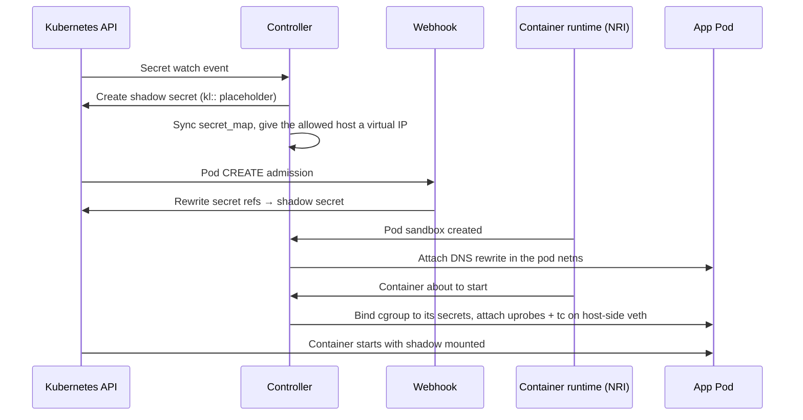

# Architecture Overview

Kloak is a Kubernetes-native secret protection system that uses eBPF to rewrite secret placeholders with real values at the kernel level, after TLS encryption. Applications never see actual secrets -- they work with harmless `kl::` placeholders that are transparently substituted in the encrypted output.

## Components

Kloak consists of three main components deployed in the `kloak-system` namespace:

### Controller (DaemonSet)

The controller runs as a **DaemonSet** -- one pod per node -- because eBPF programs must be loaded on the same kernel where the target processes run.

It performs these functions:

1. **SecretReconciler** -- Watches Kubernetes Secrets labeled `getkloak.io/enabled=true`. For each enabled secret, creates a shadow secret (`<name>-kloak`, owned by the original and labeled `getkloak.io/managed=true`) whose values are `kl::` placeholders: `kl::` followed by random characters, with exactly the same byte length and the same HPACK Huffman bit length as the real value (so HTTP/2 rewrites stay valid). A key whose value can't be rewritten is left out of the shadow while the other keys are shadowed.

2. **Secret sync** -- Whenever an enabled Secret or its shadow is created, changed or deleted, once at startup, and every 5 minutes, joins each enabled Secret with its shadow from the informer cache, reads the `getkloak.io/hosts` / `getkloak.io/port` annotations, and syncs placeholder-prefix -> real-value entries into the `secret_map` BPF map. A burst of events folds into one sync, and a failed sync is retried with backoff. There is no separate in-memory store. Every hostname in a `getkloak.io/hosts` annotation also gets a virtual IP (see [Virtual IP Host Resolution](#virtual-ip-host-resolution)).

3. **Pod Reconciler** -- Watches Pods annotated `getkloak.io/enabled=true` on the local node. It attaches the pod's DNS rewrite as soon as the pod's sandbox exists, resolves the cgroup IDs of its running containers (init containers included, while the pod is pending), binds those cgroups to the secrets the pod spec references (the `secret_acl` BPF map), then delegates to the TLS Uprobe Manager. Failed attachments are retried every 500ms (handles runtimes like Python where `libssl` loads lazily).

4. **NRI plugin** -- With containerd 2.0+ or CRI-O 1.30+, the container runtime calls the controller through NRI while it creates each pod sandbox, and before each container starts, and waits for it. The controller attaches the pod's DNS rewrite in the first call and the container's TLS uprobes in the second, so the first DNS lookup and the first TLS write of each container are already covered. Without NRI, the Pod Reconciler does both by polling.

5. **TLS Uprobe Manager** -- Loads eBPF programs into the kernel, attaches uprobes to each container process's TLS write functions, attaches the tc patch program at tc ingress on the host-side veth peer of the pod's egress interface (TCX, or a `clsact` filter on kernels before 6.6), and reads the ring buffers for binding and SNI violations. Also tracks process lifecycle (exec/exit) in tracked cgroups to attach uprobes to newly spawned processes.

6. **Trusted DNS discovery** -- Watches the `kube-system/kube-dns` Service and its EndpointSlices, and keeps the `trusted_dns_servers` BPF map current with kube-dns's ClusterIPs and endpoint addresses (answers come from the endpoints when the CNI load balances Services at the socket, as Cilium's kube-proxy replacement does). Only answers from trusted servers are rewritten to virtual IPs. Additional servers can be configured via `controller.dns.trustedServers` (the `--trusted-dns-servers` flag).

At startup the controller also checks that its virtual IP ranges don't overlap any node address, pod CIDR, service CIDR, or route of its node, and refuses to start if they do.

### Webhook (Deployment)

The webhook runs as a standard **Deployment** (typically 1 replica). It serves a mutating admission webhook for pod `CREATE` and a validating admission webhook for Secrets.

One `MutatingWebhookConfiguration` (`kloak-mutating-webhook`) contains two webhooks that ensure only kloak-enabled workloads are sent to the webhook (both use `failurePolicy: Fail` and never match the Kloak release namespace):
- **Namespace-scoped:** matches namespaces labeled `getkloak.io/enabled=true`
- **Pod-scoped:** matches pods labeled `getkloak.io/enabled=true` via `objectSelector`

Non-kloak workloads are never affected, even if the webhook is down.

When a pod is matched:

1. Checks if Kloak is enabled for this pod: if the pod has the `getkloak.io/enabled` label, its value decides (`"false"` opts out even in an enabled namespace); otherwise the namespace label decides
2. Scans Secret references in the pod spec: `volumes[].secret`, `env[].valueFrom.secretKeyRef`, and `envFrom[].secretRef` (containers, initContainers, and ephemeralContainers). Projected volume sources are not rewritten.
3. For each reference to a kloak-enabled secret, rewrites the name from `original` to `original-kloak`
4. **Rejects** the pod if any kloak-enabled secret's shadow does not exist yet or is not Kloak-managed (fail-closed)
5. Adds `getkloak.io/enabled: "true"` annotation to the pod so the controller knows to attach eBPF uprobes

A `ValidatingWebhookConfiguration` (`kloak-validating-webhook`, `failurePolicy: Fail`) checks `CREATE`/`UPDATE` of Secrets labeled `getkloak.io/enabled=true`. It rejects `getkloak.io/hosts` or `getkloak.io/port` set as labels instead of annotations, invalid or multi-host values, hosts longer than 63 bytes, invalid ports, Secrets with no data, values shorter than 8 or longer than 128 bytes, and values whose Huffman density cannot be matched by a same-length `kl::` placeholder.

### eBPF Programs

The eBPF programs run in-kernel and are loaded by the controller. The secret rewriting pipeline has three stages:

#### Stage 1: Uprobe -- Scan and Compute

When `SSL_write` or `crypto/tls.(*Conn).Write` is called, the uprobe fires and:

1. Reads the plaintext write buffer (up to 256 bytes per chunk, scanning the full buffer via `bpf_loop`)
2. Pre-scans for the `kl::` prefix (or its HPACK Huffman encoding, for HTTP/2), finding up to 4 matches per call
3. For each match, uses the 8 bytes at the match as the key to look up the real secret value in the `secret_map` BPF hash map
4. Checks that the writing pod references the secret (`secret_acl`, keyed by the writer's cgroup and the placeholder key). A binding refusal is reported to the controller on the `secret_binding_events` ring buffer.
5. Computes XOR deltas: `xor_delta[i] = shadow_byte[i] ^ real_byte[i]` for each matched secret
6. Stores the pending patches in `xor_pending` (keyed by process ID / tgid). The plaintext buffer is not modified.

The GHASH key H is obtained per connection. For OpenSSL, uprobes on libcrypto's `EVP_CipherInit_ex` capture H when the cipher is keyed and cache it in `evp_h_cache`; an `h_extract` tail call looks it up on write (or reads it live on a cache miss). If the libcrypto hook is unavailable, the `tcp_sendmsg` kprobe walks the SSL struct itself (3-hop chain for OpenSSL 3.0/3.1, 4-hop for 3.2+). For BoringSSL, H is recomputed from the AES round keys. For Go `crypto/tls`, the kprobe reads H*2 from the GCM productTable and applies GF(2^128) halving.

#### Stage 2: Kprobe -- Filter and Bridge to Network

A kprobe on `tcp_sendmsg` fires when the TLS library sends the encrypted data:

1. Reads the pending patches from `xor_pending`
2. Checks each patch against the secret's destination policy on the socket the record leaves on: for a hostname, the host the socket connected to through its virtual IP (`vip_sock_host`) and the SNI of the connection's first ClientHello (`sni_state`); for an IP or a port, the address and port the socket connected to (`vip_sock_dst`). A patch that fails a check is dropped, and an SNI refusal is reported on `secret_binding_events`.
3. Obtains H if the uprobe did not (Go, or the OpenSSL fallback walk). If H cannot be obtained, no patch is created and the placeholder is sent.
4. Builds a `tc_pending` entry keyed by `(destination IP, source port, cgroup ID)`, IPv4 or IPv6, recording the TCP write sequence number to identify the right segment
5. The patches are now ready for the tc program

#### Stage 3: TC -- Patch Ciphertext

A tc (traffic control) program attached at tc ingress on the **host-side veth peer** (as a TCX link on Linux 6.6+, or a `clsact` + `cls_bpf` filter on older kernels) of the pod's egress interface intercepts the pod's outbound IPv4 and IPv6 packets as they leave the pod. Patching outside the pod keeps the rewritten ciphertext out of reach of in-pod packet capture. Interfaces with no veth peer (e.g. `hostNetwork` pods) fall back to tc egress inside the pod netns, where a container with `CAP_NET_RAW` could capture the patched ciphertext -- drop `NET_RAW` for such workloads. Loopback is never patched, so same-pod traffic receives the placeholder.

Kloak's tc programs attach first on their hook (at the head of TCX, or at `cls_bpf` priority 1), so a CNI program that redirects packets can't hide them, and they pass every packet on, so the CNI's own programs still run.

1. Looks up `tc_pending` by matching the packet's destination IP, source port, and cgroup
2. For each patch, XORs the corresponding ciphertext bytes: `CT_real = CT_shadow XOR xor_delta`
3. Recomputes the GHASH authentication tag using precomputed H powers (GF(2^128) multiplication)
4. Patches the authentication tag in the TLS record
5. The packet leaves the node with the real secret encrypted -- the pod's memory never held the real value

::: tip Why XOR patching works
AES-GCM in counter mode (CTR) encrypts via `ciphertext = plaintext XOR keystream`. If you know the XOR difference between the shadow and real values, you can patch the ciphertext directly: `CT_real = CT_shadow XOR (shadow XOR real)`. The keystream cancels out. The GHASH tag must be recomputed because the ciphertext changed.

Only AES-128-GCM and AES-256-GCM cipher suites (TLS 1.2 and 1.3) are supported. ChaCha20-Poly1305 connections are not rewritten and send the placeholder.
:::

#### Go `crypto/tls`

Go `crypto/tls` uses the same XOR-patch pipeline. There is no plaintext fallback: if H cannot be obtained, the placeholder is sent.

#### Virtual IP Host Resolution

Additional eBPF programs decide which host a connection is for:

- **DNS rewrite** (`tc_dns_rewrite`, tc ingress on the pod's own interface, inside its network namespace) -- For a pod that references a secret restricted to a hostname (`vip_pod_host`), replaces the host's A records in answers from a trusted resolver (`trusted_dns_servers`) with its virtual IPv4, and its AAAA records with its virtual IPv6, and records the real addresses with their TTL in `vip_upstream`. Other pods get the real answers.
- **Connect redirect** (`cgroup/connect4`, `cgroup/connect6` on the kubepods cgroup) -- Sends a connect to a virtual IP to one of the host's real addresses, or refuses it when none is known, and records the host the socket is for (`vip_sock_host`). For every TCP socket, also records the address and port it connected to (`vip_sock_dst`), before a CNI's socket load balancer replaces a Service's ClusterIP with a backend's.
- **getpeername** (`cgroup/getpeername4`, `cgroup/getpeername6`) -- Reports the virtual IP back to the application as its peer.
- **SNI capture** (a second `tcp_sendmsg` kprobe, and the `sock/inet_sock_set_state` tracepoint) -- Parses each connection's first ClientHello into `sni_state`, and clears the entry when the socket connects again or closes.
- **Connect Tracepoints** (`sys_enter/exit_connect`, `sys_enter_close`) -- Track the TCP connections a process makes (fd to destination in `conn_ip_map`), which tells them apart from the connections it accepts.

The controller allocates the virtual IPs from `--virtual-ip-range` and keeps them in `vip_host_ip` / `vip_ip_host`. These maps and `vip_upstream` are pinned under `/sys/fs/bpf/kloak`, so a controller restart keeps the virtual IPs applications may have cached and where they lead. A virtual IP whose host is no longer in any annotation stays reserved for that host for a while, so it is not handed to another host while applications may still cache it.

## Admission Flow

When a secret and pod are created, the controller and webhook set up the shadow secret and mutate the pod:



## Secret Rewrite Flow

When the application makes a TLS call, the eBPF pipeline rewrites the secret in the encrypted output:

```mermaid
sequenceDiagram
    participant App as App Pod
    participant DNS as DNS rewrite (pod netns)
    participant CG as Connect hook
    participant UP as Uprobe
    participant TLS as TLS Library
    participant KP as tcp_sendmsg Kprobe
    participant TC as TC (host-side veth)
    participant Net as Network

    App->>DNS: resolve api.stripe.com
    DNS-->>App: virtual IP (real addresses recorded)
    App->>CG: connect(virtual IP)
    CG->>Net: connect(real address), socket host = api.stripe.com
    App->>UP: SSL_write(kl:: placeholder)
    UP->>UP: Scan buffer, lookup secret, check binding
    UP->>UP: Compute XOR delta (plaintext untouched)
    UP->>TLS: Continue (encrypts placeholder)
    TLS->>KP: tcp_sendmsg
    KP->>KP: Check socket host, SNI, IP/port; bridge patch to tc_pending
    KP->>TC: Encrypted packet leaves the pod
    TC->>TC: XOR ciphertext + recompute GHASH
    TC->>Net: Real secret (encrypted)
```

## Security Model

Real secret values never enter application memory. The application only sees `kl::` placeholders. Real values exist in the original Secret (API server/etcd), in the controller's informer cache (which holds all Secrets cluster-wide), and in kernel-space BPF maps -- all inaccessible to application containers. The XOR-patch pipeline injects secrets into the ciphertext on the host side of the pod's veth, after TLS encryption, so they never pass through the pod's memory (except on interfaces without a veth peer, see above).

For the full threat model, trust chain, fail modes, and known limitations, see the [Security Model](/architecture/security-model) page.

## BPF Map Layout

### Core Maps

| Map | Type | Key | Value | Purpose |
|---|---|---|---|---|
| `secret_map` | Hash | First 8 bytes of the placeholder (`kl::xxxx`) or of its HPACK Huffman encoding | Real value (128B) + host (64B) + IP (16B) + port + protocol + full prefix (42B) | Placeholder-to-secret lookup (max 4096 entries; each secret uses up to 2) |
| `secret_acl` | Hash | {cgroup ID, placeholder key} | 1 | Per-pod secret binding: which containers may redeem which placeholders (max 65536 entries) |
| `secret_binding_mode` | Array | 0 | `enforce` or `audit` | Set from `--secret-binding` |
| `tls_conn_state` | LRU Hash | {tgid, ssl_ptr} | GHASH H (16B) + H powers (16x16B) + cipher type | Per-connection TLS state for GHASH recomputation |
| `xor_pending` | Hash | tgid | Patches (up to 4) with offset, length, XOR delta | Uprobe to kprobe bridge: pending ciphertext patches |
| `tc_pending` | LRU Hash | {dst IP, src port, cgroup ID} | Patches + TCP write sequence | Kprobe to tc bridge: patches for a specific connection |
| `tc_tag_pending` | LRU Hash | {dst IP, src port, cgroup ID} | GHASH tag delta | Deferred tag fix-up when the tag is in a later TCP segment |
| `evp_h_cache` | LRU Hash | {tgid, EVP_CIPHER_CTX ptr} | GHASH H | H captured at OpenSSL `EVP_CipherInit_ex` time |

### Virtual IPs and SNI

| Map | Type | Key | Value | Purpose |
|---|---|---|---|---|
| `vip_host_ip` | Hash (pinned) | Hostname (64B) | Virtual IPv4 + virtual IPv6 | Each watched host's virtual IPs |
| `vip_ip_host` | Hash (pinned) | Virtual IP (16B) | Hostname (64B) + flags | Virtual IP to host, including retired reservations |
| `vip_upstream` | Hash (pinned) | Virtual IP (16B) | Up to 4 real addresses, each with its expiry | Where a connect to a virtual IP goes |
| `vip_config` | Array | 0 | IPv4 and IPv6 ranges | The virtual IP ranges |
| `vip_pod_host` | Hash | {pod IP, hostname} | 1 | The hosts whose DNS answers are rewritten for each pod |
| `vip_sock` | Socket storage | socket | Virtual IP, real IP, port | What `getpeername` reports |
| `vip_sock_host` | LRU Hash | Socket cookie | Hostname (64B) | The host a socket connected to through its virtual IP |
| `vip_sock_dst` | LRU Hash | Socket cookie | IP (16B) + port | The address and port a TCP socket connected to |
| `sni_state` | LRU Hash | `struct sock *` | SNI status + hostname (64B) | SNI of each connection's first ClientHello |
| `sni_check_mode` | Array | 0 | `enforce` or `audit` | Set from `--sni-check` |
| `trusted_dns_servers` | Hash | IP address (16B) | 1 | Resolvers whose answers are rewritten |
| `conn_ip_map` | LRU Hash | {tgid, fd} | IP address (16B) + port | Connections a process made (as opposed to accepted) |

### Process and Container Tracking

| Map | Type | Key | Value | Purpose |
|---|---|---|---|---|
| `tracked_cgroups` | Hash | cgroup inode ID | 1 | Container cgroups whose TLS writes are scanned (registered by the controller, and by the exec tracepoint for container execs) |
| `tracked_tgids` | Hash | tgid | 1 | Container processes seen by the exec tracepoint |

### Program Control

| Map | Type | Key | Value | Purpose |
|---|---|---|---|---|
| `prog_array` | ProgArray | Index 1-2 | Program FDs | Tail calls: 1=XOR patch, 2=H extract |
| `tc_prog_array` | ProgArray | Index 0 | Program FD | TC tail call: GHASH tag recomputation |
| `secret_binding_events` | RingBuf | -- | Cgroup ID, tgid, audit flag, placeholder key, reason | Binding and SNI violations, logged by the controller |
| `proc_events` | RingBuf | -- | Exec/exit events | Process lifecycle events for uprobe attachment |
